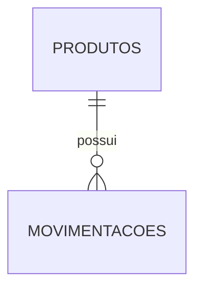

# Almoxarifado com API REST e SQLite

Cadastre e edite produtos, filtre por nome, SKU ou categoria e acompanhe o estoque mínimo. Cada entrada ou saída atualiza o saldo e gera um registro no histórico.

> O fluxo começa no formulário em `public/index.html`, passa pelo `fetch()` em `public/app.js` e chega à rota em `server.js`. Abra `schema.sql` para ver onde cada campo é guardado.

## Rodar offline

Requer **Node.js 24 ou superior**. Com o repositório clonado, execute:

```powershell
cd 04-almoxarifado-api
node server.js
```

Abra <http://127.0.0.1:3000>. O aplicativo usa módulos nativos do Node.js. O servidor cria `estoque.sqlite` na pasta do projeto no primeiro uso. Para levar os dados a outro computador, encerre o servidor e copie o arquivo SQLite junto com o código. A variável `PORT` permite trocar a porta.

## API

| Método | Rota | Dados e resultado |
| --- | --- | --- |
| GET | `/api/produtos` | Lista de produtos com saldo e mínimo |
| POST | `/api/produtos` | Recebe `sku`, `nome`, `categoria` e `minimo`. Retorna o ID |
| PUT | `/api/produtos/:id` | Recebe os mesmos campos do cadastro e preserva o saldo |
| GET | `/api/movimentacoes` | Histórico com nome e SKU do produto |
| POST | `/api/movimentacoes` | Recebe `produtoId`, `tipo` (`ENTRADA` ou `SAIDA`), `quantidade` e `observacao` opcional. Retorna ID e saldo |

> Para entender uma rota da tabela acima, pense no verbo como a ação e no caminho como o recurso. Por exemplo, `POST /api/produtos` pede para cadastrar um produto.

## Banco e regras

[O script SQL](schema.sql) cria as tabelas. Cada produto tem um SKU único e pode ter várias movimentações vinculadas por chave estrangeira. Todo produto começa com saldo zero. A movimentação aceita quantidades inteiras positivas. A saída acima do saldo é recusada. O saldo e o histórico são gravados na mesma transação SQLite.



> Separe três coisas ao testar: o que digitou, o que esperava e o que realmente aconteceu. Se a operação for recusada, confira tanto o saldo quanto o histórico.

## Roteiro de teste

1. Cadastre MAT-01 com mínimo 5 e registre entrada de 10.
2. Registre saída de 6. Confira saldo 4, alerta de estoque baixo e dois registros no histórico.
3. Tente saída de 5. Confira que o saldo e o histórico continuam iguais.
4. Reinicie o servidor e confira a persistência. Teste editar o nome do produto e confirme que o saldo permanece 4.
