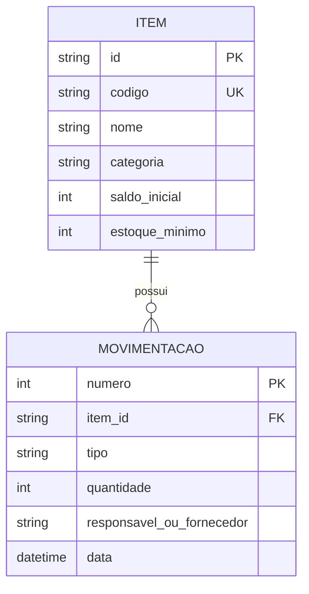

# Almoxarifado — Modelo preenchido

## Objetivo

Cadastre materiais, acompanhe o saldo e registre entradas e saídas.

## Execução

Abra `index.html` da pasta `01-almoxarifado` no Edge ou Chrome. O navegador armazena os dados localmente. O backup JSON transfere os dados entre cópias do mesmo projeto.

## Requisitos funcionais

- **RF01** — Cadastrar materiais com código único e categoria.
- **RF02** — Registrar entradas e saídas e manter um histórico.
- **RF03** — Destacar materiais com saldo menor ou igual ao mínimo.

## Regra de negócio

**RN01** — Uma saída maior que o saldo disponível é recusada sem gravar histórico.

## Diagrama de dados

O diagrama representa os dados do app. A aplicação usa armazenamento local. O [script SQL](modelos.sql) propõe um esquema relacional separado para o caso de a atividade exigir banco de dados.

## Roteiro de teste

1. Cadastre MAT-01, Papel A4, saldo inicial 10 e mínimo 5.
2. Registre saída de 6 e confira saldo 4, alerta de estoque baixo e histórico.
3. Tente saída de 5 e confira que o saldo continua 4 e o histórico fica igual.
4. Recarregue a página e confira se o catálogo e o histórico persistiram.
5. Exporte o JSON e confira se a importação recupera os registros nesse mesmo projeto.
