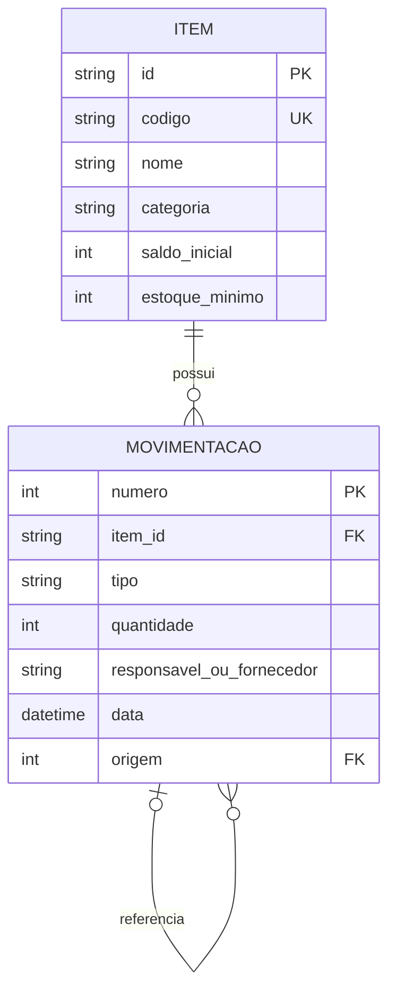

# Empréstimo de ferramentas — Modelo preenchido

## Objetivo

Acompanhe a disponibilidade e vincule cada devolução à retirada original.

## Execução

Abra `index.html` da pasta `02-ferramentas` no Edge ou Chrome. O navegador armazena os dados localmente. O backup JSON transfere os dados entre cópias do mesmo projeto.

## Requisitos funcionais

- **RF01** — Cadastrar ferramentas e consultar saldo disponível.
- **RF02** — Registrar retiradas por responsável.
- **RF03** — Vincular devoluções totais ou parciais à retirada original.

> Leia cada RF como uma tarefa que dá para demonstrar na tela. A regra de negócio descreve quando a ação deve passar ou ser bloqueada.

## Regra de negócio

**RN01** — A devolução total acumulada não pode ultrapassar a quantidade retirada.

## Diagrama de dados

O diagrama representa os dados do app. A aplicação usa armazenamento local. O [script SQL](modelos.sql) propõe um esquema relacional separado para o caso de a atividade exigir banco de dados.

> No diagrama acima, PK identifica o registro, FK liga a outro registro e UK indica valor único. O lado `o{` permite zero ou muitos registros relacionados.

## Roteiro de teste

1. Cadastre FER-01, Furadeira, saldo inicial 5 e mínimo 1.
2. Registre retirada de 3 para Ana e devolva 1 vinculada a essa retirada. Confira saldo 3 e 2 pendentes.
3. Tente devolver 3 para a mesma retirada. Confira que a operação é recusada.
4. Recarregue a página e confira se o catálogo e o histórico persistiram.
5. Exporte o JSON e confira se a importação recupera os registros nesse mesmo projeto.
