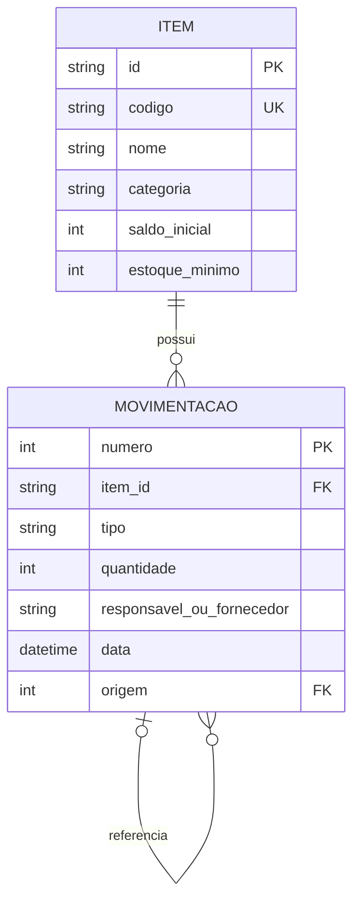

# Compras e reposição — Modelo preenchido

## Objetivo

Registre consumo, identifique itens abaixo do mínimo e acompanhe pedidos de compra.

## Execução

Com Node.js 24 ou superior, entre na pasta `03-reposicao` e rode `node server.js`. Abra <http://127.0.0.1:3003>. A aplicação funciona offline e usa os módulos nativos do Node.js. Para iniciar o banco com três pedidos de exemplo, pare o servidor e rode `node seed.js`. O script cria três insumos com estoque baixo e três pedidos pendentes. Se o banco já tiver dados, ele não os altera.

O primeiro início cria o usuário de treino **`operador`**, com a senha **`SAEP2026!`**. Para usar outra senha, defina a variável de ambiente `REPOSICAO_SENHA_INICIAL` antes de criar o banco. O SQLite grava o hash e o sal da senha. A sessão termina ao clicar em **Sair**, ao vencer após 12 horas ou ao reiniciar o servidor.

O arquivo `reposicao.sqlite` é criado na pasta do projeto. Para trazer registros da versão anterior, exporte o backup JSON nessa versão e importe no painel depois de entrar.

## Requisitos funcionais

- **RF01** — Cadastrar insumos, registrar consumo e destacar saldo baixo.
- **RF02** — Abrir pedidos com fornecedor.
- **RF03** — Registrar recebimento parcial ou total e cancelar o saldo pendente.
- **RF04** — Entrar com um usuário cadastrado e encerrar a sessão pelo botão **Sair**.

> Leia cada RF como uma tarefa que dá para demonstrar na tela. A regra de negócio descreve quando a ação deve passar ou ser bloqueada.

## Regra de negócio

**RN01** — O saldo físico só aumenta no recebimento. O cancelamento fecha a quantidade pendente sem mexer no saldo físico.

## Diagrama de dados

O diagrama representa os dados de estoque dentro do JSON. O [esquema em uso](../03-reposicao/schema.sql) tem uma tabela `usuarios` para credenciais e uma tabela `estoque` para o JSON do catálogo e do histórico. O arquivo [modelos.sql](modelos.sql) traz um exemplo de como distribuir o estoque em tabelas relacionais.

> No diagrama acima, PK identifica o registro, FK liga a outro registro e UK indica valor único. O lado `o{` permite zero ou muitos registros relacionados.

## Roteiro de teste

1. Cadastre INS-01, Luvas de proteção, saldo inicial 5 e mínimo 4. Registre consumo de 2.
2. Abra pedido de 10 e receba 4 informando o pedido. Confira saldo físico 7 e 6 pendentes.
3. Cancele as 6 restantes. Confira que o pedido sai da lista de pendências e o saldo permanece 7.
4. Recarregue a página e confira se o catálogo e o histórico persistiram.
5. Exporte o JSON e confira se a importação recupera os registros nesse mesmo projeto.
6. Clique em **Sair**. Confira que a tela de login volta e que `GET /api/estoque` responde com HTTP 401.
7. Entre novamente com a conta de treino e confira que o saldo e o histórico continuam no banco.
