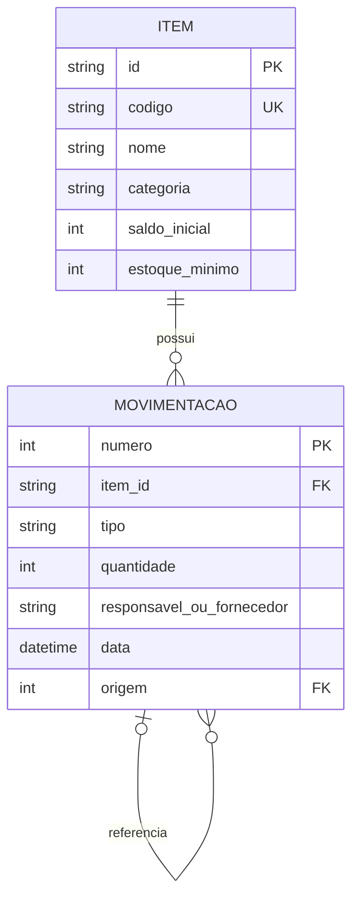

# Compras e reposição — Modelo preenchido

## Objetivo

Registre consumo, identifique itens abaixo do mínimo e acompanhe pedidos de compra.

## Execução

Abra `index.html` da pasta `03-reposicao` no Edge ou Chrome. O navegador armazena os dados localmente. O backup JSON transfere os dados entre cópias do mesmo projeto.

## Requisitos funcionais

- **RF01** — Cadastrar insumos, registrar consumo e destacar saldo baixo.
- **RF02** — Abrir pedidos com fornecedor.
- **RF03** — Registrar recebimento parcial ou total e cancelar o saldo pendente.

## Regra de negócio

**RN01** — O saldo físico só aumenta no recebimento. O cancelamento fecha a quantidade pendente sem mexer no saldo físico.

## Diagrama de dados

O diagrama representa os dados do app. A aplicação usa armazenamento local. O [script SQL](modelos.sql) propõe um esquema relacional separado para o caso de a atividade exigir banco de dados.

## Roteiro de teste

1. Cadastre INS-01, Luvas de proteção, saldo inicial 5 e mínimo 4. Registre consumo de 2.
2. Abra pedido de 10 e receba 4 informando o pedido. Confira saldo físico 7 e 6 pendentes.
3. Cancele as 6 restantes. Confira que o pedido sai da lista de pendências e o saldo permanece 7.
4. Recarregue a página e confira se o catálogo e o histórico persistiram.
5. Exporte o JSON e confira se a importação recupera os registros nesse mesmo projeto.
